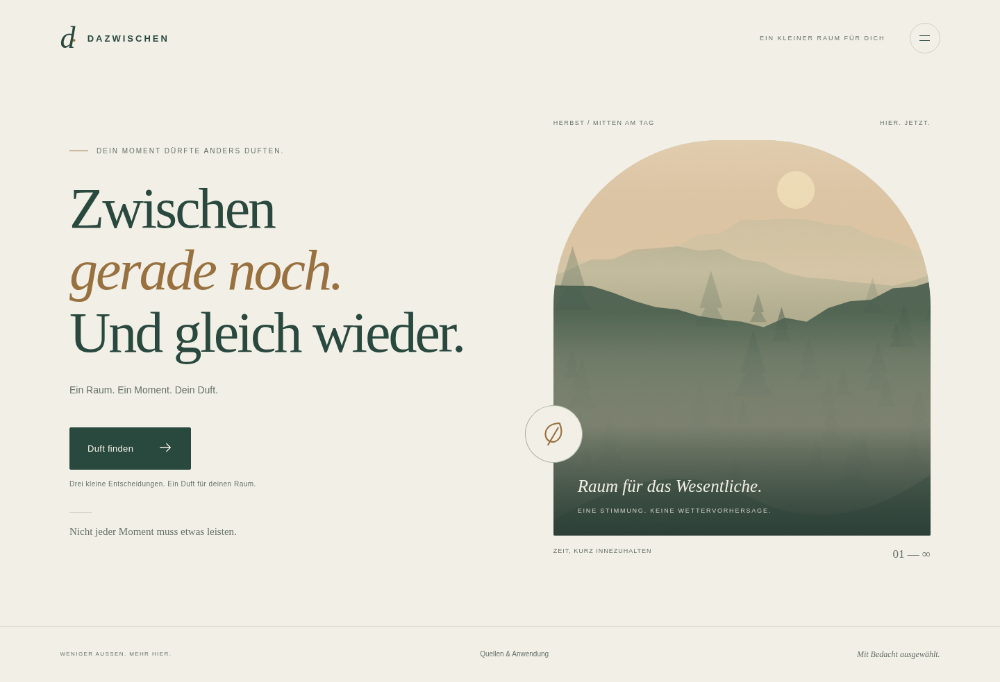

# DAZWISCHEN

Drei Fragen führen direkt zu einer Duftidee. Der Einstieg beginnt sofort mit der Tätigkeitsauswahl.

Eine deutschsprachige Duftauswahl für den kleinen Raum zwischen Tätigkeiten. Drei Fragen führen zu genau einer redaktionell ausgewählten Duftidee aus dem verfügbaren Bestand. Eigene lokale Landschaftsillustrationen wechseln mit Tageszeit, Jahreszeit und Datum. Keine Besucheraccounts, keine laufende KI, keine Tracker und keine externen Medienabrufe.

Der neue Name folgt dem jüngsten Auftrag. Die bisherige öffentliche Adresse wurde weder ersetzt noch verändert.

## Design ansehen und Quellcode herunterladen

Die folgenden Bilder zeigen den implementierten und im Browser geprüften Stand:



[Mobile Startseite](docs/preview/start-mobile.png) · [Duftrichtung](docs/preview/duftrichtung-mobile.png) · [Intensität](docs/preview/intensitaet-mobile.png) · [Ergebnis](docs/preview/ergebnis-mobile.png)

Die Designüberarbeitung entfernt die vorgeschaltete Einstiegsseite, Mottos, Bildbeschriftungen, dekorative Zahlen und die Antwort-Chips im Ergebnis. Ein statischer Lichtkörper trägt die saisonalen Motive. Antworten werden gezielt über „Auswahl ändern“ bearbeitet. Details: [Gestaltungsentscheidungen und Prüfstand](docs/design.md).

Das vollständige Projekt lässt sich auf GitHub über **Code → Download ZIP** herunterladen. Der Quellcode enthält keine Datenbank, Passwörter, Sitzungen oder Einrichtungsschlüssel. Ein GitHub-Download ist noch keine öffentlich laufende Website.

## Info und automatisches Farbschema

Die kleine Info-Schaltfläche im Kopfbereich öffnet eine freiwillige, scrollbare räumliche Demo. Drei eigene geschwungene Glasbänder öffnen sich und verbinden sich zu einer gemeinsamen Form. Anwendung und Quellen sind dort sofort erreichbar; der frühere Footer-Link entfällt. Schließen erhält den laufenden Quiz- oder Ergebnisstand.

Die gesamte Oberfläche folgt automatisch dem hellen bzw. dunklen Systemfarbschema, unabhängig von Tageszeit und saisonalen Motiven. Demo-Code wird erst bei Bedarf geladen; reduzierte Bewegung, Datensparen und fehlendes WebGL erhalten eine hochwertige statische Alternative. Keine neuen Laufzeitabhängigkeiten.

[Konzept und geprüfte Grenzen](docs/info.md) · [Übernahme in das vorhandene Hosting](docs/hosting-handoff.md)

## Start

Voraussetzung: **Node.js 24 LTS** (hier geprüft mit 24.19.0), npm. Keine Laufzeitpakete und kein Bundle-Build. Die einzige Entwicklungsabhängigkeit ist Playwright für reale Browserprüfungen.

```bash
cd /workspace/Duft-Moment
npm ci --ignore-scripts --no-audit --no-fund --cache /workspace/.npm-cache
npm run setup
npm start
```

Der Server bindet standardmäßig nur an `127.0.0.1`, Port `3000`. Für die lokale Arbeit im eigenen Browser diese Adresse verwenden. Die Onboarding-Oberfläche stellt keine Webvorschau bereit; es wird kein öffentlicher Link durch den lokalen Start erzeugt.

Umgebungsvariablen:

| Name | Standard | Zweck |
| --- | --- | --- |
| `PORT` | `3000` | Serverport |
| `HOST` | `127.0.0.1` | Bindeadresse; für einen Hostingdienst passend setzen |
| `DATA_DIR` | `.data` im Projekt | Privater dauerhafter SQLite-Speicher außerhalb des öffentlich ausgelieferten Ordners |
| `APP_ORIGIN` | lokale Hostadresse | Im Produktivbetrieb die exakte öffentliche HTTPS-Origin ohne abschließenden Slash |
| `NODE_ENV` | nicht gesetzt | Mit `production` wird eine HTTPS-`APP_ORIGIN` zwingend verlangt |
| `CHROMIUM_PATH` | `/usr/bin/chromium` | Vorhandener Browser für den optionalen Browsertest |

`npm run setup` kann wiederholt werden. Es initialisiert nur fehlende Daten; individuelle Inhalte, Passwort und Bestandsmarkierungen werden erhalten. Es startet keinen Hintergrundprozess. Ein neues Task hat bereits eine isolierte Umgebung: den vorhandenen Checkout nutzen und keinen Git-Worktree anlegen, sofern nicht ausdrücklich gewünscht.

## Verwaltung erstmalig einrichten

Im Menü **Verwaltung** öffnen. Vor der ersten Einrichtung legt der Server einen kryptographisch zufälligen Schlüssel in `DATA_DIR/setup-token` an. Die Datei ist privat, liegt außerhalb des öffentlichen Webverzeichnisses und wird weder geloggt noch per API ausgegeben. Der Serverbetreiber liest sie ausschließlich über seinen geschützten Terminal-/Dateizugriff und gibt den Schlüssel in das Einrichtungsformular ein. Kein Schlüssel gehört in Git, Chat, Setupskript oder öffentliche Umgebungsvariable.

Danach ein eigenes Passwort mit mindestens zwölf Zeichen und mindestens fünf unterschiedlichen Zeichen wählen. Die PIN `1111` wird nicht verwendet. Nach erfolgreicher Einrichtung werden Schlüsseldatei und gespeicherter Schlüsselhash entfernt, die Ersteinrichtung bleibt gesperrt. Bestehende Konten werden beim Start niemals überschrieben.

Scrypt mit zufälligem Salt schützt das Passwort. Sitzungen bestehen aus 256 zufälligen Bits; nur deren SHA-256-Hash liegt in SQLite. Ablauf nach acht Stunden. HttpOnly, SameSite=Strict und bei HTTPS Secure. Jeder Schreibzugriff braucht eine Sitzung und eine passende Origin; Login/Setup verlangen ebenfalls die passende Origin. Höchstens acht fehlgeschlagene Versuche pro direkter Client-IP innerhalb 15 Minuten. Bei vorgeschaltetem Proxy werden keine ungeprüften Forwarded-Header vertraut: gegebenenfalls zusätzlich Anmeldebegrenzung am eigenen Proxy konfigurieren, da alle Clients dort eine gemeinsame IP haben können.

Bestand, Produktspezifikation, Quellen/Freigaben, Rezepte, Zuordnungen, Prioritäten, Gerät, Grenzen, Hausstandard, Texte, Bildaktivierung und Jahreszeitenwechsel sind bearbeitbar. Speichern erfolgt gemeinsam mit optimistischer Versionsprüfung. Alte Tabs überschreiben keinen neueren Stand. Exporte enthalten nur Inhalte, keine Authentifizierung. Importformat ist explizit Schema 1; unbekannte Formate werden zurückgewiesen. Inhaltsreset setzt den Zugang nicht zurück.

## Auswahl und fachlicher Prüfstand

Alle **23 übermittelten Produkte** sind als verfügbar modelliert. „Aus Bestand übernommen“ ist keine wissenschaftliche oder unabhängige Produktfreigabe. Neu hinzugefügte Produkte starten gesperrt für die Auswahl, bis sie ausdrücklich klassifiziert werden.

Die Ausgangsquellen und alte Referenz waren wegen einer Netzwerkproxysperre nicht zugänglich. Deshalb zeigt die aktuelle Anwendung **Verhältnisse, keine Tropfenanweisungen**. Die gewählte Intensität wird vor der dokumentierten Prüfung nicht in Mengen umgesetzt. Es wurden keine angeblich bestätigten Herstellerhöchstmengen erfunden. Hintergründe und konkrete Nachprüfungen stehen in [research/notes.md](research/notes.md).

Der Datenpfad ist: verfügbare und nicht ausgeschlossene Ölvariante → vorhandenes redaktionelles Rezept → Tätigkeit und Duftrichtung → Dosierbarkeit bei dokumentierter Prüfung → schwache Tageszeit-/Prioritätsgewichtung → Rotation innerhalb ähnlich passender Rezepte. Dosierbarkeit ist eine harte Bedingung, kein Bonus. Gleiche Ölzusammenstellungen werden dedupliziert. „Andere Mischung“ wiederholt bei passenden Alternativen nicht sofort dieselbe Zusammensetzung. Fehlt eine exakte Passung, wird nur eine vorhandene Alternative gleicher Duftrichtung mit sichtbarem Hinweis angeboten. Sonst entsteht ein ehrlicher leerer Zustand.

Serenity ist ausschließlich dem Ausklang zugeordnet, nicht Lernen. Bergamot Mint ist kein Alias für Peppermint. Aufwachen erscheint nur von 06:00 bis vor 11:00 Uhr der Besucherzeit bzw. bewusst manuell eingestellter Uhrzeit. Die manuelle Zeit gilt nur für den Besuch. Hausstandard ist lediglich eine sichtbare Empfehlung, keine versteckte Vorauswahl. Die Tätigkeitsfrage ist die Startseite; vor dem Anzeigen der Duftrichtungen und jeder neuen Empfehlung wird der aktuelle Bestand geprüft. Der bisherige Einstiegstext bleibt gespeichert und in der Verwaltung erreichbar, wird im direkten Einstieg jedoch nicht angezeigt.

Quizantworten bleiben im Arbeitsspeicher. Kein Local Storage, keine Besuchercookies, kein Wiederherstellen alter Antworten. Home, erneutes Öffnen und BFCache-Wiederherstellung beginnen frisch. Die flüchtige Rotationshistorie enthält nur Rezeptzusammensetzungen und wird beim Schließen des Tabs verworfen.

## Prüfungen

```bash
npm run check
npm test
npm run test:browser
npm run test:info
# Nur nach Änderungen an der 3D-Szene: kompakte ruhige Ansichten regenerieren
npm run build:info-stills
```

`check` prüft die JavaScript-Syntax, das vollständige Ausgangsschema und alle 24 lokalen Motive. Der Browserlauf nutzt echtes Chromium über Playwright. Auf anderen Rechnern einen bereits installierten kompatiblen Chromium-Browser über `CHROMIUM_PATH` angeben; die optionalen Browserprüfungen setzen diesen voraus. Screenshots entstehen in `test-results/` (Git-ignoriert). Die ausgewählten Ansichten unter `docs/preview/` sind auf GitHub direkt zugänglich.

Tests verwenden eigene temporäre Datenordner, verändern niemals die eigentliche Installation und geben keine echten Einrichtungsschlüssel aus. Geprüft sind Auswahl/Rotation, Dosierungsbedingungen, lokale Zeitgrenzen, Produktstatus, Schema, Authentifizierung, Origin-Schutz, Anmeldesperre, Sitzungsablauf, Konflikte, Neustartpersistenz und Byte-Ranges. Browserprüfungen decken Besucherablauf, mobile Ansichten, Alternative, Home, Netzwerkrennen, manuelle Uhrzeit, Verwaltungsabläufe und aktuelle Bestandsänderungen ab. BFCache wird über sein tatsächliches `pageshow`-Ereignis mit `persisted` geprüft; das ist keine Garantie für jeden browserabhängigen Cachepfad.

## Veröffentlichung und alte Adresse

**Noch nicht veröffentlicht.** Hier ist kein Werkzeug oder Hostingzugang für die bisherige Adresse verfügbar:

`https://duftmoment-julian.julian-rehberger.chatgpt.site`

Der lauffähige Neuaufbau ist ein kleiner Node-HTTP-Dienst mit SQLite. Er kann nicht als reine statische Seite oder unverändert als Cloudflare-Worker betrieben werden. Für den Betrieb unter der alten Adresse ist der Zugriff auf das bestehende Hostingprojekt und dessen Routing nötig; alternativ müsste dessen Betreiber eine tatsächliche Weiterleitung einrichten. Erst eine geprüfte Veröffentlichung bzw. Weiterleitung erhält die Funktion des alten QR-Codes. Eine neue URL allein tut das nicht.

Für ein geeignetes Node-Hosting: HTTPS-Terminierung, `NODE_ENV=production`, exakte `APP_ORIGIN`, passende `HOST`-/`PORT`-Werte und ein **dauerhaft beschreibbares privates Volume** für `DATA_DIR` konfigurieren. Einen einzelnen Node-Prozess pro Datenverzeichnis verwenden. SQLite schützt lokale Transaktionen, ist kein regionsübergreifender Serverless-Speicher. Vor Aktualisierung die Datenbank mit der SQLite-Backupfunktion oder bei gestopptem Prozess samt WAL sichern; nicht nur eine laufende Hauptdatei kopieren. Sitzungscookies/-daten sind keine Inhaltsmigration.

Die frühere Installation und ihre Daten sind nicht erreichbar; es wurde kein Export, Passwort, Ausschluss oder eigenes Rezept übernommen. Vor einem Umschalten erst einen geschützten Export und gegebenenfalls die bestehende Authentifizierungsintegration klären. Ein Wechsel darf diese Daten nicht unbemerkt verwerfen. Der Inhaltsexport dieses Neubaus enthält bewusst keine Passworthashes.

## Projektstruktur

- `public/`: statische Oberfläche, lokale Auswahlregel, gemeinsamer Validator und eigene SVG-Motive.
- `src/catalog.mjs`: 23 Produkte, 17 redaktionelle Rezepte und Ausgangseinstellungen.
- `src/server.mjs`: HTTP, SQLite, Authentifizierung, Versionsschutz und Auslieferung.
- `test/`: automatisierte Auswahl- und Serverprüfungen.
- `scripts/browser.mjs`: echte Chromium-Klickabläufe.
- `scripts/info-browser.mjs`: zusätzliche echte Prüfungen für Info, WebGL, Farbschemata und Ressourcenfreigabe.
- `public/info-demo.mjs`, `public/info-room.mjs`, `public/info-demo.css`: bei Bedarf geladene Info-Erfahrung.
- `research/notes.md`: Quellenstatus, Dosierungsgrenzen und fehlende Migration.
- `public/assets/credits.json`: Mediennachweise; kein fremdes Video, keine Fremdschrift.

Keine offizielle Partnerschaft oder Freigabe durch doTERRA oder Stadler Form. Kein Marken- oder Domainverfügbarkeitsnachweis für DAZWISCHEN.
