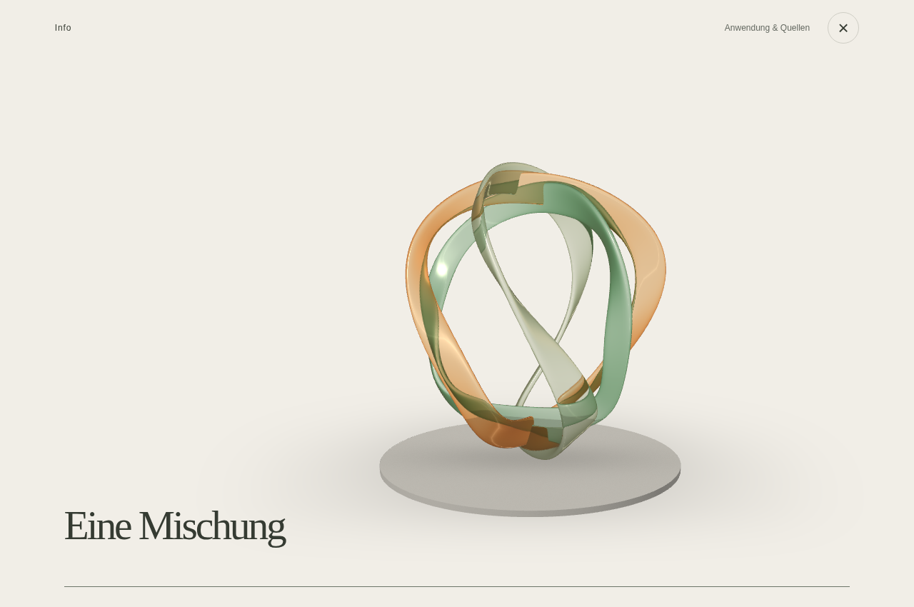
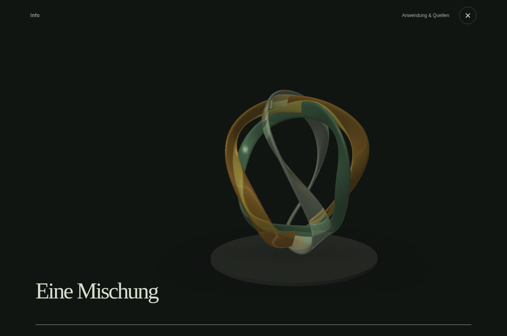

# Info und automatisches Farbschema

## Hauptablauf

Der dauerhaft sichtbare Footer-Link wurde entfernt. „Info“ sitzt mit mindestens 44 × 44 CSS-Pixeln im Kopfbereich neben dem Menü. Fachlich notwendige Einschränkungen stehen weiterhin direkt beim Rezept; ihr Detailzugang öffnet die Anwendungshinweise ohne Demo. Auch das Menü behält den direkten Quellenzugang.

Kleinere Überschriften, weniger enge Laufweite und eine zurückhaltendere Materialbeleuchtung beruhigen den Hauptablauf. Die Info-Erfahrung ist freiwillig und verändert keine Quizantworten oder Empfehlungen.

## Ein räumlicher Zusammenhang

Drei geschwungene Glasbänder stehen für einzelne Duftnoten. Der native Scrollstand öffnet ihre gemeinsame Silhouette, fächert die Profile räumlich auf und verbindet sie schließlich in unterschiedlichen Ebenen zu einer neuen Form. Das Bild zeigt eine freie Duftstudie, kein Herstellergerät oder konkretes Rezept. Sichtbar sind lediglich „Drei Noten.“, „Im Zusammenspiel.“ und „Eine Mischung“.

Die vorherigen abgerundeten Platten wurden vollständig ersetzt. Die neue Szene setzt auf organisch geschwungene Profile, polierte Kanten, getöntes Glas, einen flachen steinernen Sockel und zusammenhängendes Studiolicht. Durchsicht und Lichtbrechung werden als gestalterische Näherung aus dem bereits gezeichneten Hintergrund berechnet. Keine physikalische Simulation oder Wirkungsbehauptung.

Eigene prozedurale Geometrie und ein kleiner WebGL-Renderer kommen ohne Grafikbibliothek oder fremde Modelle und Texturen aus. Alle Veränderungen folgen direkt der Scrollposition, einschließlich Rückwärtsbewegung. Die Kamera berücksichtigt die Geometriegrenzen von Bändern und Sockel, auch auf schmalen Displays. Das Bild bleibt im hellen und dunklen Systemmodus eigens beleuchtet.

Der Kopfbereich mit „Anwendung & Quellen“ und Schließen bleibt sichtbar. Die Quellen sind vor jeder Scrollbewegung erreichbar. Kein Scroll-Hijacking, automatisches Scrollen, Ton oder obligatorisches Intro.

## Laden und Ressourcen

`info-demo.mjs` und `info-demo.css` werden erst beim Öffnen geladen; `info-room.mjs` erst bei tatsächlich benötigtem 3D. Der normale Quizstart lädt kein Demo-Modul und erzeugt keinen Grafikkontext.

Frames entstehen nur nach Scrollen, Größenänderung oder Schemawechsel. Keine kontinuierliche Render-Schleife. Unsichtbare Tabs pausieren. Beim Schließen werden RAF, Listener, ResizeObserver, Buffer, Shader, Hintergrundtextur, Programm und Grafikkontext freigegeben. Die maximale Pixeldichte beträgt 1,5, der Zeichenpuffer ist auf etwa 1,1 Millionen Pixel begrenzt. Das sind interne Rendergrenzen, keine behaupteten Geräte-Leistungsdaten.

Reduzierte Bewegung, Datensparmodus und konservativ erkannte schwache Geräte (höchstens 2 GB gemeldeter Speicher oder höchstens zwei logische Prozessoren) verwenden ein kompaktes Standbild aus genau derselben prozeduralen Szene, im passenden Farbschema. Die beiden lokalen WebP-Dateien umfassen zusammen etwa 29 KB und werden ausschließlich bei Bedarf geladen; eine funktionierende 3D-Ansicht lädt sie nicht. `npm run build:info-stills` erzeugt sie reproduzierbar aus der Szene. Bei fehlendem oder verlorenem WebGL entsteht derselbe Fallback ohne unnötige lange Scrollstrecke. Die Browserangaben werden weder gespeichert noch versandt. Unbekannte Geräteprofile werden nicht als schwach behauptet.

## Navigation und Zustand

Info ist ein bildschirmfüllender nativer Dialog mit einem eigenen scrollbaren Inhalt. Ein flüchtiger History-Eintrag erlaubt Browser-Zurück und Vorwärts. Schließen und Escape kehren zum unveränderten Quizschritt bzw. Ergebnis zurück; die vorherige Fokusposition wird ohne Scrollsprung wiederhergestellt. Es erfolgt weder ein neuer Konfigurationsabruf noch eine neue Empfehlung durch das Schließen. Ein doppeltes Schließen springt nicht mehrfach im Verlauf zurück. Ein abgebrochener Lazy-Ladevorgang öffnet später keinen veralteten Dialog. Home und ein neuer Besuch beginnen weiterhin frisch.

## Hell und Dunkel

`prefers-color-scheme` und passende `theme-color`-Metadaten gelten ab dem ersten Laden. Texte, Konturen, Buttons, Fokus, Menüs, Formulare, Verwaltung, Meldungen und Materialien besitzen passende helle und dunkle Farben. Systemwechsel verändern keine Tageszeit- oder Jahreszeitenmotive. Bewegte Text- und Button-Farbübergänge wurden vermieden, damit beim Live-Wechsel keine kurzzeitig unleserlichen Kontraste entstehen.

## Tatsächliche Prüfung

- 24 unveränderte automatische Fach-/Servertests.
- 18 bestehende echte Chromium-Prüfungen des Hauptablaufs, einschließlich Smartphone, Tablet, Desktop und Verwaltung.
- 18 zusätzliche echte Info-/Schema-Prüfungen: Lazy Loading, reversible Scrollgeometrie, fehlerfreies WebGL, sofortiger Quellenzugang, Zustands- und Fokusrückkehr, Browser-Zurück/Vorwärts, Live-Schemawechsel, reduzierte Bewegung mit echten geladenen Standbildern und Live-Schemawechsel, Datensparen, schwaches Geräteprofil, fehlender/verlorener Grafikkontext, Ressourcenfreigabe, Navigation während des Ladens, erhaltene Verwaltungseingaben und Quellenzugriff bei nicht erreichbarer Konfiguration.

Zusätzlich visuell kontrolliert: 320 × 568, 360 × 640, 390 × 844, 768 × 1024, 844 × 390 und Desktop.

WebGL wurde im Chromium-Test mit einem Software-Grafiktreiber tatsächlich gerendert. Screenshots zeigen reale Browserausgaben; sie sind kein Nachweis der Bildrate auf jedem Smartphone. Safe Areas sind im CSS berücksichtigt, es wurde kein physisches Gerät mit Displayausschnitt vermessen.

## Hosting

Diese Änderungen betreffen ausschließlich die Oberfläche. Der vorhandene Server, die Auswahlregel, Produkt-/Rezeptdaten und der Validator bleiben bytegenau unverändert. Kein Konto, Passwort, Bestand oder gespeicherter Inhalt wurde durch die Überarbeitung zurückgesetzt.

Im zugänglichen GitHub-Branch ist kein zusätzlicher Sites-Adapter vorhanden. Die öffentliche Adresse antwortete beim Zugriff aus dieser Umgebung mit HTTP 403. Ein Sites-Veröffentlichungswerkzeug steht hier nicht zur Verfügung. Deshalb ist die Website unter ihrer bisherigen Adresse nicht als aktualisiert bestätigt. Hinweise zur Übernahme in das vorhandene Hosting: `docs/hosting-handoff.md`.

## Ansichten aus dem tatsächlichen Browserlauf

[Hauptansicht hell](preview/start-mobile.png) · [Hauptansicht dunkel](preview/start-dark-mobile.png) · [3D-Start](preview/info-start.png) · [Entfaltung](preview/info-middle.png) · [Dunkle mobile Demo](preview/info-dark-mobile.png) · [Statische Alternative](preview/info-static.png)

